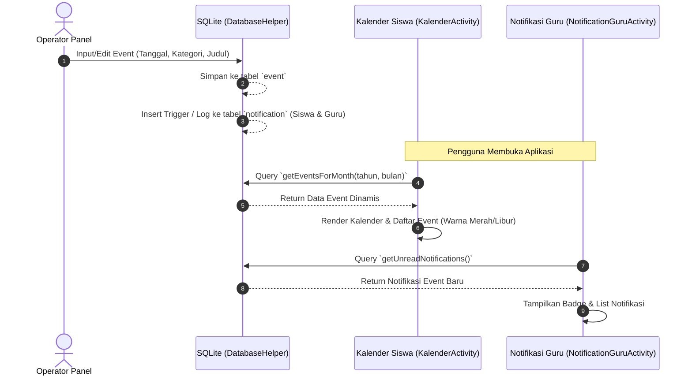

# Analisis Mendalam & Rencana Perbaikan UI/UX dan Sinkronisasi Data

Dokumen ini berisi hasil analisa mendalam terhadap 7 masalah yang ditemukan pada aplikasi Absensi Siswa Proto, mencakup *root cause*, file terkait, dampak UX, rencana perbaikan bertahap, prioritas, estimasi *effort*, serta strategi eksekusi.

---

## 1. Analisis Detail 7 Masalah

### MASALAH 1: Ukuran Layout Tidak Konsisten (Siswa, Guru, Operator)
- **Root Cause:** Panel dashboard untuk berbagai peran (Siswa, Guru, Operator) dibangun sebagai *standalone layout* secara terpisah dengan nilai margin, *padding*, dan tinggi *header* yang di-*hardcode* secara berbeda tanpa menggunakan resource terpusat (`dimens.xml`) atau style global yang konsisten.
- **File Terkait:**
  - `app/src/main/res/layout/activity_beranda.xml`
  - `app/src/main/res/layout/component_header.xml`
- **Dampak ke User Experience:** Terjadi ketidakpastian visual (*visual jarring*) ketika pengguna bernavigasi antar peran, serta rentan pecah pada perangkat berukuran layar kecil atau tablet.
- **Rencana Perbaikan:**
  1. Ekstrak konstanta ukuran umum (margin, padding, ukuran teks header) ke dalam `app/src/main/res/values/dimens.xml`.
  2. Standardisasi penggunaan `component_header.xml` di semua aktivitas beranda.
  3. Terapkan *style* global untuk container card utama.
- **Prioritas:** Medium
- **Estimasi Effort:** 3 jam

### MASALAH 2: Ukuran Button di Beranda Tidak Konsisten
- **Root Cause:** Menu grid dan komponen kartu menu (`component_menu_card.xml`, `component_menu_grid.xml`) memiliki padding internal, ukuran ikon, dan ukuran teks yang bervariasi serta tidak memenuhi standar minimum *touch target* Material Design (minimal 48dp).
- **File Terkait:**
  - `app/src/main/res/layout/component_menu_card.xml`
  - `app/src/main/res/layout/component_menu_grid.xml`
- **Dampak ke User Experience:** Tombol menu sulit ditekan pada layar kecil, tampilan tidak simetris, dan estetika visual terlihat kurang profesional.
- **Rencana Perbaikan:**
  1. Unifikasi padding kartu menu (misal: seragam di `16dp` atau `20dp`).
  2. Pastikan ukuran minimum tap target tercapai (min 48x48dp) menggunakan *layout gravity* dan *minimum height/width*.
  3. Terapkan *selectable background* atau *ripple effect* yang konsisten.
- **Prioritas:** High
- **Estimasi Effort:** 2 jam

### MASALAH 3: Animasi Fingerprint
- **Root Cause:** Tombol fingerprint pada navigasi bawah atau halaman autentikasi kurang responsif karena transisi animasi drawable tidak mulus, tidak adanya *haptic feedback* (`performHapticFeedback`), atau adanya *frame drops* pada *Vector Drawable animation*.
- **File Terkait:**
  - `app/src/main/java/com/example/absensisiswaproto/ui/beranda/BerandaActivity.kt` (event listener tombol fingerprint)
  - `app/src/main/res/drawable/bg_nav_circle_fingerprint.xml`
  - `app/src/main/res/drawable/ic_fingerprint.xml`
- **Dampak ke User Experience:** Pengguna merasa ragu apakah sentuhan mereka terdeteksi karena kurangnya umpan balik visual dan taktil secara instan.
- **Rencana Perbaikan:**
  1. Tambahkan pemanggilan `view.performHapticFeedback(HapticFeedbackConstants.VIRTUAL_KEY)` pada aksi klik tombol fingerprint.
  2. Optimalkan animasi scale/alpha menggunakan `ObjectAnimator` atau `StateListAnimator` yang ringan.
  3. Pastikan transisi status aktif/non-aktif berjalan di *main thread* dengan mulus tanpa *blocking*.
- **Prioritas:** Medium
- **Estimasi Effort:** 2 jam

### MASALAH 4: UI Maskot Belum Terpasang di Beberapa Layout
- **Root Cause:** Ilustrasi maskot (seperti `siswa_kiri.png`, `siswa_kanan.png`, dll.) belum diintegrasikan ke dalam layout sekunder seperti aktivitas absensi (`AbsenActivity`) dan pemindaian (`ScanAbsenActivity`) akibat pembaruan desain yang belum menyeluruh.
- **File Terkait:**
  - `app/src/main/res/layout/activity_absen.xml`
  - `app/src/main/res/layout/activity_scan_absen.xml`
  - `app/src/main/java/com/example/absensisiswaproto/ui/absen/AbsenActivity.kt`
- **Dampak ke User Experience:** Antarmuka pada halaman absen dan scan terasa kosong/hambar dan kurang memperkuat identitas visual aplikasi.
- **Rencana Perbaikan:**
  1. Tambahkan `ImageView` untuk maskot pada area kosong (misalnya di sudut header atau bagian bawah *empty state*).
  2. Pastikan posisi maskot menggunakan *ConstraintLayout guidelines* agar aman dari *overlap* dengan konten utama.
- **Prioritas:** Low
- **Estimasi Effort:** 1.5 jam

### MASALAH 5: Posisi Maskot Tidak Sesuai UI (Welcome Page / Login)
- **Root Cause:** Penempatan maskot figur pada halaman *Welcome* atau *Login* menggunakan margin statis atau *constraint* yang kaku, sehingga ketika rasio aspek layar berubah (misalnya layar HP panjang vs pendek), maskot bertumpuk (*overlap*) dengan tombol Login/Daftar atau terpotong di tepi layar.
- **File Terkait:**
  - `app/src/main/res/layout/activity_login.xml`
  - `app/src/main/res/layout/activity_splash.xml`
- **Dampak ke User Experience:** Tombol aksi utama tertutup gambar maskot, membuat pengguna kesulitan melakukan login.
- **Rencana Perbaikan:**
  1. Perbaiki *constraint* pada `ImageView` maskot relatif terhadap *guideline* vertikal/horizontal persentase.
  2. Atur tinggi maksimum gambar maskot menggunakan `app:layout_constraintDimensionRatio` agar skalabel di berbagai ukuran layar.
- **Prioritas:** High
- **Estimasi Effort:** 2 jam

### MASALAH 6: Kategori di CRUD Event Operator
- **Root Cause:** Pengelolaan kategori event (Libur / Upacara / Event) pada form operator bermasalah karena kurangnya adaptor kustom untuk Spinner/Dropdown, inkonsistensi string kategori antara saat input dan database, serta tidak adanya indikator titik warna (*dot color*) kategori.
- **File Terkait:**
  - Form event / dialog operator (perlu dibuat atau diperiksa jika ada di aktivitas terkait)
  - `app/src/main/java/com/example/absensisiswaproto/data/local/DatabaseHelper.kt`
- **Dampak ke User Experience:** Operator salah memasukkan kategori atau kategori gagal disimpan/ditampilkan dengan warna yang sesuai.
- **Rencana Perbaikan:**
  1. Buat kustom `ArrayAdapter` (`KategoriAdapter`) untuk Spinner yang menampilkan titik warna status kategori.
  2. Pastikan skema tabel `event` di `DatabaseHelper` menyimpan kolom kategori secara konsisten (`Libur`, `Upacara`, `Event`).
  3. Sinkronisasi nilai default antara mode *Add* dan *Edit*.
- **Prioritas:** High
- **Estimasi Effort:** 3 jam

### MASALAH 7: Sinkronisasi Data Operator ↔ Kalender ↔ Notifikasi Guru & Siswa
- **Root Cause:**
  1. Kalender siswa (`KalenderActivity.kt`) saat ini masih menggunakan data *hardcoded* (`monthlyEvents` map) alih-alih mengambil data dinamis dari tabel `event` di SQLite (`DatabaseHelper`).
  2. Query filter tanggal (`getAllEventBulan`, `getEventMendatang`) kurang presisi atau format tanggal tidak seragam (`yyyy-MM-dd`).
  3. Pembuatan event oleh operator tidak memicu notifikasi otomatis ke tabel `notification` untuk guru dan siswa.
- **File Terkait:**
  - `app/src/main/java/com/example/absensisiswaproto/data/local/DatabaseHelper.kt`
  - `app/src/main/java/com/example/absensisiswaproto/ui/kalender/KalenderActivity.kt`
  - `app/src/main/java/com/example/absensisiswaproto/ui/notifikasi/NotificationActivity.kt`
- **Dampak ke User Experience:** Informasi libur atau event penting dari operator tidak muncul di kalender siswa/guru serta tidak ada notifikasi yang masuk, menyebabkan miskomunikasi jadwal.
- **Rencana Perbaikan:**
  1. Migrasikan `KalenderActivity.kt` untuk melakukan *query* langsung ke `DatabaseHelper.getEventsForMonth(...)` menggantikan map *hardcoded*.
  2. Pastikan format tanggal di SQLite konsisten (`yyyy-MM-dd`).
  3. Tambahkan fungsi *trigger* penambahan notifikasi ke tabel `notification` setiap kali operator berhasil menambah/mengedit event.
- **Prioritas:** High
- **Estimasi Effort:** 4 jam

---

## 2. Diagram Alur Data Sinkronisasi Event (Masalah 7)

---

## 3. Strategi Eksekusi & Rencana Sprint

### A. Urutan Prioritas Pengerjaan
1. **Prioritas 1 (Kritis / Fungsionalitas Utama):** Masalah 7 (Sinkronisasi Data & Kalender Dinamis) & Masalah 6 (CRUD Event Operator).
2. **Prioritas 2 (UX & Layout Core):** Masalah 2 (Button Beranda Konsisten) & Masalah 5 (Posisi Maskot Login/Welcome).
3. **Prioritas 3 (Polish & Detail):** Masalah 1 (Konsistensi Layout Dashboard), Masalah 3 (Animasi Fingerprint), & Masalah 4 (Maskot UI Tambahan).

### B. Ketergantungan Antar Masalah (Dependencies)
- **Masalah 7 bergantung pada Masalah 6:** Perbaikan CRUD event operator (Database & Form) harus diselesaikan terlebih dahulu sebelum Kalender Siswa (Masalah 7) dapat menarik data dinamis dari tabel yang sama.

### C. Quick Win (Dampak Cepat dengan Usaha Minim)
- **Masalah 2 & 5:** Memperbaiki padding `component_menu_card.xml` dan *constraint* maskot di halaman login dapat diselesaikan dengan cepat (`~2 jam`) dan langsung memberikan peningkatan visual yang drastis pada perangkat fisik.

### D. Pembagian Rencana Sprint (3 Tahap)
- **Sprint 1 (Mendesak / Urgent):**
  - Masalah 6: Perbaikan CRUD & Kategori Event Operator.
  - Masalah 7: Migrasi Kalender Siswa dari *hardcoded* ke Database dinamis + Notifikasi Event.
- **Sprint 2 (Penting / Important):**
  - Masalah 2: Standarisasi ukuran & padding *menu card* beranda.
  - Masalah 5: Perbaikan posisi maskot di halaman Login/Welcome.
  - Masalah 3: Peningkatan animasi & *haptic feedback* fingerprint.
- **Sprint 3 (Nice-to-Have / Polish):**
  - Masalah 1: Unifikasi dimensi layout dashboard (`dimens.xml`).
  - Masalah 4: Penambahan ilustrasi maskot di `AbsenActivity` & `ScanAbsenActivity`.

---
*Catatan: Dokumen ini disusun untuk tahap perencanaan (*Refining*). Belum ada perubahan kode sumber yang dilakukan.*
